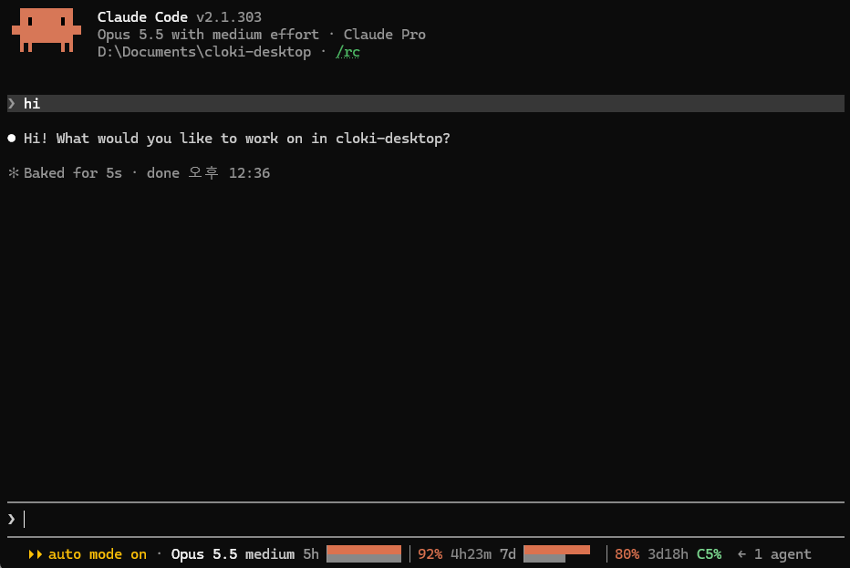

# bar-claude-meter

**English** | [한국어](README.ko.md)

See how much of your Claude usage is left, right under the prompt in Claude Code.



The line under the prompt shows your model and effort, a bar each for the 5-hour and the weekly (7-day) limits, and how full your context window is. You can see how close you are to a limit without typing `/usage`.

## Reading the line

```
Opus 5.5 medium  5h▕██████▏92% 4h23m  7d▕█████ ▏80% 3d18h  C5%
```

| Part | Meaning |
| --- | --- |
| `Opus 5.5 medium` | Current model and effort. Effort appears after your first message. |
| `5h` bar | The 5-hour usage limit. |
| `7d` bar | The weekly usage limit. |
| `92%` (orange) | Usage **left** in that window. |
| `4h23m` (gray) | Time left until that window resets. |
| `C5%` | Context window used. Turns red at 80%. |

Each bar is two bars in one row:

- **Top half, orange:** usage left.
- **Bottom half, gray:** time left before the reset.

If the orange bar is longer than the gray one, you are using less than your pace allows. If the gray bar is longer, you are using it up faster than time passes and may hit the limit before it resets.

You also get a notification when a 5-hour or weekly limit reaches 80% and again at 90% used.

On narrow terminals the line shortens itself: below 90 columns the numbers are hidden, and below 70 columns the `5h`/`7d` labels go too.

## Before you install

- **Claude Code**, signed in with a **Claude subscription** (Pro or Max). With an API key there are no 5-hour or weekly limits, so no bars appear.
- Tested with Claude Code v2.1.303. Check yours with `claude --version`, and update with `claude update` if it is older.

## Install

**Easiest: ask Claude.** Paste `Install the plugin from https://github.com/greenoceanplanet/bar-claude-meter` into Claude Code. It runs steps 1–2 below for you; then restart Claude Code (or type `/reload-plugins`).

To do it yourself:

Run these inside Claude Code (in the prompt, not in your system shell).

**1. Add the marketplace.** This tells Claude Code where to find the mod.

```
/plugin marketplace add greenoceanplanet/bar-claude-meter
```

**2. Install the mod.**

```
/plugin install bar-claude-meter@bar-claude-meter
```

`bar-claude-meter@bar-claude-meter` means "the `bar-claude-meter` mod from the `bar-claude-meter` marketplace".

**3. Restart Claude Code.** Quit with `/exit` (or Ctrl+C twice) and run `claude` again.

**4. Send any message.** The bars appear once Claude has answered, because usage figures arrive with each response.

If you prefer menus, type `/plugin`, open **Marketplaces** to add `greenoceanplanet/bar-claude-meter`, then pick `bar-claude-meter` from **Discover**.

> Mods run with the same access as Claude Code itself; they are not sandboxed. The source is short. Read [`hooks/register.tsx`](hooks/register.tsx) and [`hooks/meter.ts`](hooks/meter.ts) before installing if you like.

## Getting updates

Marketplaces you add yourself do not update automatically by default. To turn automatic updates on:

1. Type `/plugin` and open **Marketplaces**.
2. Select **bar-claude-meter**.
3. Choose **Enable auto-update**.

Claude Code then checks for a new version when it starts. To update by hand instead:

```
/plugin marketplace update bar-claude-meter
```

Restart Claude Code after an update.

## Uninstall

```
/plugin uninstall bar-claude-meter@bar-claude-meter
/plugin marketplace remove bar-claude-meter
```

## Troubleshooting

| Problem | What to check |
| --- | --- |
| No bars at all | Send one message first. If still nothing, check that you are signed in with a subscription and not an API key (`/status`). |
| Only some parts show | Your terminal is narrow. Widen the window to 90 columns or more to see the numbers. |
| `/plugin` not found | Update Claude Code: `claude update`. |

## Credits

Based on [usage-meter](https://github.com/0xGondarxyz/usage-meter) by 0xGondarxyz (MIT).

## License

MIT. See [`LICENSE`](LICENSE).
